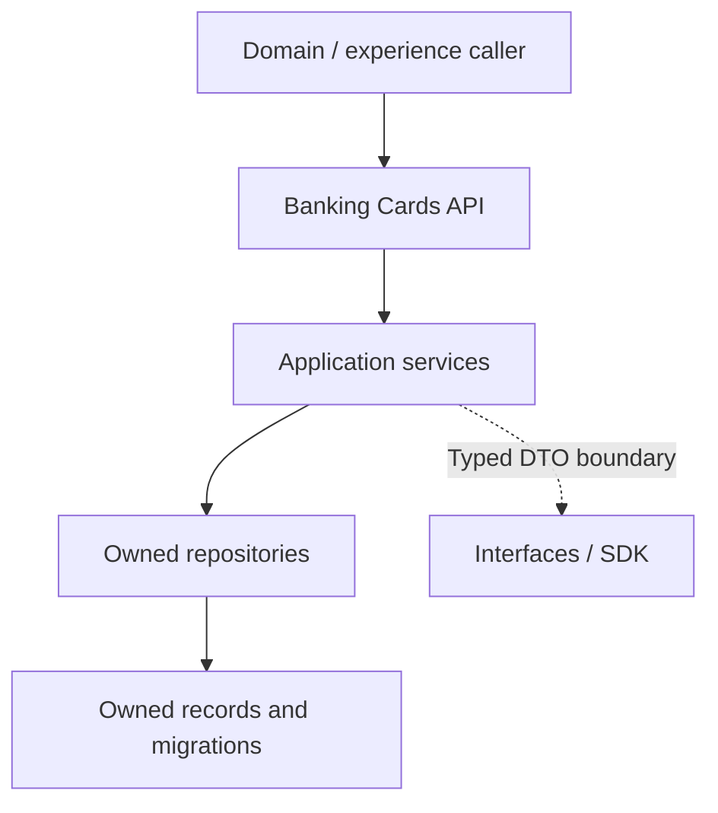

<a href="https://fireflysoftware.io/openplatform/">
<picture>
  <source media="(max-width: 640px) and (prefers-color-scheme: dark)" srcset="https://raw.githubusercontent.com/fireflysoftwaresolutions/.github/main/profile/assets/banner-narrow-dark.svg">
  <source media="(max-width: 640px)" srcset="https://raw.githubusercontent.com/fireflysoftwaresolutions/.github/main/profile/assets/banner-narrow-light.svg">
  <source media="(prefers-color-scheme: dark)" srcset="https://raw.githubusercontent.com/fireflysoftwaresolutions/.github/main/profile/assets/banner-dark.svg">
  
</picture>
</a>

# Banking Cards

Core data service for card records, limits, controls, transactions, and lifecycle history in Firefly OpenPlatform.

[Platform documentation](https://docs.fireflysoftware.io/) · [Source reference](docs/openplatform/reference.md) · [Source inventory](docs/openplatform/source-inventory.json)

## Purpose, scope, and readiness

This service owns card records, limits, controls, transactions, and lifecycle history. Its controllers expose typed record operations; services and repositories apply the local persistence and lifecycle behavior. Domain and experience services compose those operations into customer or staff journeys.

The current source contains the declarations indexed in the companion reference. Functional readiness is bounded by the implemented handlers, adapters, and tests; this guide does not elevate a record API, sample provider, or unexecuted test into a completed business journey.

Card record creation and update reject every non-null PIN or CVV; responses and ordinary mapping omit both fields. Read the [authentication-data boundary](docs/card-authentication-data.md) for historical-row protection, database guards, filtering restrictions and the remaining processor/PAN work. This correction is separate from complete card issuance and activation.

## Business ownership and supported journeys

Maintain the card inventory and the configuration a card journey needs for issuance, activation, blocking, replacement, and cancellation.

A card record does not provision a card at a processor or prove network authorization. Issuer/processor adapters and domain coordination must complete those effects.

| Entry point | Declared operations |
| --- | --- |
| [CardAcquirerController](core-banking-cards-web/src/main/java/io/fireflysoftware/core/banking/cards/web/controllers/acquirer/v1/CardAcquirerController.java) | `GET /api/v1/acquirers`; `GET /api/v1/acquirers/{acquirerId}`; `POST /api/v1/acquirers`; 2 more declarations |
| [CardActivityController](core-banking-cards-web/src/main/java/io/fireflysoftware/core/banking/cards/web/controllers/activity/v1/CardActivityController.java) | `GET /api/v1/cards/{cardId}/activities`; `GET /api/v1/cards/{cardId}/activities/{activityId}`; `POST /api/v1/cards/{cardId}/activities`; 2 more declarations |
| [CardBalanceController](core-banking-cards-web/src/main/java/io/fireflysoftware/core/banking/cards/web/controllers/balance/v1/CardBalanceController.java) | `GET /api/v1/cards/{cardId}/balances`; `GET /api/v1/cards/{cardId}/balances/{balanceId}`; `POST /api/v1/cards/{cardId}/balances`; 2 more declarations |
| [BINController](core-banking-cards-web/src/main/java/io/fireflysoftware/core/banking/cards/web/controllers/bin/v1/BINController.java) | `GET /api/v1/bins`; `GET /api/v1/bins/{binId}`; `POST /api/v1/bins`; 2 more declarations |
| [CardController](core-banking-cards-web/src/main/java/io/fireflysoftware/core/banking/cards/web/controllers/card/v1/CardController.java) | `GET /api/v1/cards/{cardId}`; `POST /api/v1/cards/filter`; `POST /api/v1/cards`; 2 more declarations |
| [CardConfigurationController](core-banking-cards-web/src/main/java/io/fireflysoftware/core/banking/cards/web/controllers/configuration/v1/CardConfigurationController.java) | `GET /api/v1/cards/{cardId}/configurations`; `GET /api/v1/cards/{cardId}/configurations/{configId}`; `POST /api/v1/cards/{cardId}/configurations`; 2 more declarations |
| [CardDisputeController](core-banking-cards-web/src/main/java/io/fireflysoftware/core/banking/cards/web/controllers/dispute/v1/CardDisputeController.java) | `GET /api/v1/cards/{cardId}/disputes`; `GET /api/v1/cards/{cardId}/disputes/{disputeId}`; `POST /api/v1/cards/{cardId}/disputes`; 2 more declarations |
| [CardEnrollmentController](core-banking-cards-web/src/main/java/io/fireflysoftware/core/banking/cards/web/controllers/enrollment/v1/CardEnrollmentController.java) | `GET /api/v1/cards/{cardId}/enrollments`; `GET /api/v1/cards/{cardId}/enrollments/{enrollmentId}`; `POST /api/v1/cards/{cardId}/enrollments`; 2 more declarations |
| [CardGatewayController](core-banking-cards-web/src/main/java/io/fireflysoftware/core/banking/cards/web/controllers/gateway/v1/CardGatewayController.java) | `GET /api/v1/gateways`; `GET /api/v1/gateways/{gatewayId}`; `POST /api/v1/gateways`; 2 more declarations |
| [CardInterestController](core-banking-cards-web/src/main/java/io/fireflysoftware/core/banking/cards/web/controllers/interest/v1/CardInterestController.java) | `GET /api/v1/cards/{cardId}/interests`; `GET /api/v1/cards/{cardId}/interests/{interestId}`; `POST /api/v1/cards/{cardId}/interests`; 2 more declarations |
| [IssuerController](core-banking-cards-web/src/main/java/io/fireflysoftware/core/banking/cards/web/controllers/issuer/v1/IssuerController.java) | `GET /api/v1/issuers`; `GET /api/v1/issuers/{issuerId}`; `POST /api/v1/issuers`; 2 more declarations |
| [CardLimitController](core-banking-cards-web/src/main/java/io/fireflysoftware/core/banking/cards/web/controllers/limit/v1/CardLimitController.java) | `GET /api/v1/cards/{cardId}/limits`; `GET /api/v1/cards/{cardId}/limits/{limitId}`; `POST /api/v1/cards/{cardId}/limits`; 2 more declarations |
| [CardMerchantController](core-banking-cards-web/src/main/java/io/fireflysoftware/core/banking/cards/web/controllers/merchant/v1/CardMerchantController.java) | `GET /api/v1/merchants`; `GET /api/v1/merchants/{merchantId}`; `POST /api/v1/merchants`; 2 more declarations |
| [CardNetworkController](core-banking-cards-web/src/main/java/io/fireflysoftware/core/banking/cards/web/controllers/network/v1/CardNetworkController.java) | `GET /api/v1/networks`; `GET /api/v1/networks/{networkId}`; `POST /api/v1/networks`; 2 more declarations |
| [CardPaymentController](core-banking-cards-web/src/main/java/io/fireflysoftware/core/banking/cards/web/controllers/payment/v1/CardPaymentController.java) | `GET /api/v1/cards/{cardId}/payments`; `GET /api/v1/cards/{cardId}/payments/{paymentId}`; `POST /api/v1/cards/{cardId}/payments`; 2 more declarations |
| [PhysicalCardController](core-banking-cards-web/src/main/java/io/fireflysoftware/core/banking/cards/web/controllers/physical/v1/PhysicalCardController.java) | `GET /api/v1/cards/{cardId}/physical-cards`; `GET /api/v1/cards/{cardId}/physical-cards/{physicalCardId}`; `POST /api/v1/cards/{cardId}/physical-cards`; 2 more declarations |
| [CardProgramController](core-banking-cards-web/src/main/java/io/fireflysoftware/core/banking/cards/web/controllers/program/v1/CardProgramController.java) | `GET /api/v1/programs`; `GET /api/v1/programs/{programId}`; `POST /api/v1/programs`; 2 more declarations |
| [CardPromotionController](core-banking-cards-web/src/main/java/io/fireflysoftware/core/banking/cards/web/controllers/promotion/v1/CardPromotionController.java) | `GET /api/v1/cards/{cardId}/promotions`; `GET /api/v1/cards/{cardId}/promotions/{promotionId}`; `POST /api/v1/cards/{cardId}/promotions`; 2 more declarations |
| [CardProviderController](core-banking-cards-web/src/main/java/io/fireflysoftware/core/banking/cards/web/controllers/provider/v1/CardProviderController.java) | `GET /api/v1/cards/{cardId}/providers`; `GET /api/v1/cards/{cardId}/providers/{providerId}`; `POST /api/v1/cards/{cardId}/providers`; 2 more declarations |
| [CardSecurityController](core-banking-cards-web/src/main/java/io/fireflysoftware/core/banking/cards/web/controllers/security/v1/CardSecurityController.java) | `GET /api/v1/cards/{cardId}/security`; `GET /api/v1/cards/{cardId}/security/{securityId}`; `POST /api/v1/cards/{cardId}/security`; 2 more declarations |
| [CardTerminalController](core-banking-cards-web/src/main/java/io/fireflysoftware/core/banking/cards/web/controllers/terminal/v1/CardTerminalController.java) | `GET /api/v1/terminals`; `GET /api/v1/terminals/{terminalId}`; `POST /api/v1/terminals`; 2 more declarations |
| [CardTransactionController](core-banking-cards-web/src/main/java/io/fireflysoftware/core/banking/cards/web/controllers/transaction/v1/CardTransactionController.java) | `GET /api/v1/cards/{cardId}/transactions`; `GET /api/v1/cards/{cardId}/transactions/{transactionId}`; `POST /api/v1/cards/{cardId}/transactions`; 2 more declarations |
| [VirtualCardController](core-banking-cards-web/src/main/java/io/fireflysoftware/core/banking/cards/web/controllers/virtual/v1/VirtualCardController.java) | `GET /api/v1/cards/{cardId}/virtual-cards`; `GET /api/v1/cards/{cardId}/virtual-cards/{virtualCardId}`; `POST /api/v1/cards/{cardId}/virtual-cards`; 2 more declarations |

The complete [operation reference](docs/openplatform/reference.md#http-operations) lists each mapping and its owning method. These are source declarations; conditional beans, inherited controllers, security filters, and deployment routing can change the effective runtime API.

## Consumer example: create a card record

Start with this repository-owned executable contract before connecting a full runtime. Use the JDK required by the effective parent, Maven, and the matching internal artifacts. The selected test defines its own collaborators; no provider credentials should be added to it. Run from this repository root:

```sh
mvn -B -pl core-banking-cards-core -am test -DskipOpenApiGen \
  -Dtest=CardServiceTest -Dsurefire.failIfNoSpecifiedTests=false
```

Runtime integration remains gated on the service configuration and selected adapters described below. The local port and bean-selection inventory below distinguishes the declared abstraction from its configured implementation. An SDK client is an outbound integration; its presence does not establish a working provider connection. Where a sandbox adapter is selected, its behavior is synthetic and limited to what that adapter implements.

**Inputs and fixture ownership.** The complete linked test class supplies its imports, setup, synthetic IDs and collaborators. Run that class as shown; the excerpt is not a standalone Java program. Mocked collaborators include `CardRepository`, `CardMapper`. For a deployed call, replace fixture IDs with IDs returned by the owning record-creation API and keep tenant/parent associations intact. The request values and assertions below describe this test boundary only.

```java
@BeforeEach
    void setUp() {
        // Initialize test data
        LocalDateTime now = LocalDateTime.now();
        LocalDateTime expirationDate = now.plusYears(3);

        cardDTO = CardDTO.builder()
                .cardId(cardId)
                .contractId(contractId)
                .accountId(accountId)
                .cardTypeId(UUID.randomUUID())
                .cardStatus(CardStatusEnum.ACTIVE)
                .issuerId(UUID.randomUUID())
                .issuanceDate(now)
                .expirationDate(expirationDate)
                .isPhysical(true)
                .build();

        card = new Card();
        card.setCardId(cardId);
        card.setContractId(contractId);
        card.setAccountId(accountId);
        card.setCardTypeId(UUID.randomUUID());
        card.setCardStatus(CardStatusEnum.ACTIVE);
        card.setIssuerId(UUID.randomUUID());
        card.setIssuanceDate(now);
        card.setExpirationDate(expirationDate);
        card.setIsPhysical(true);
    }

@Test
    void createCard_Success() {
        // Arrange
        when(cardMapper.toEntity(any(CardDTO.class))).thenReturn(card);
        when(cardRepository.save(any(Card.class))).thenReturn(Mono.just(card));
        when(cardMapper.toDTO(any(Card.class))).thenReturn(cardDTO);

        // Act & Assert
        StepVerifier.create(cardService.createCard(cardDTO))
                .expectNext(cardDTO)
                .verifyComplete();

        verify(cardMapper).toEntity(cardDTO);
        verify(cardRepository).save(card);
        verify(cardMapper).toDTO(card);
    }
```

**Expected behavior.** CardDTO is converted to the owned entity, saved, and converted back. This does not issue a plastic/virtual card at a network.

**Verification and recovery.** Run the complete selected test class and inspect its Surefire result: zero failures/errors and at least one executed test are required. A skipped or zero-test build is not evidence. Compare the assertions with the owning DTO/service before extending the request. For a runtime run, separately configure authentication/entitlements and the exact downstream endpoints, migrate/seed disposable owner stores, and reread the returned identifier; these unit/contract fixtures do not establish those prerequisites.

**Execution evidence.** Source checked against the linked test and local declarations. The documentation worker has not run this repository test or the full service. The excerpt is retained from the existing test; mock, in-memory, or local HTTP fixture results are not live-provider acceptance.

Source of this example: [CardServiceTest](core-banking-cards-core/src/test/java/io/fireflysoftware/core/banking/cards/core/services/card/v1/CardServiceTest.java), [CardMapper](core-banking-cards-core/src/main/java/io/fireflysoftware/core/banking/cards/core/mappers/card/v1/CardMapper.java), [CardDTO](core-banking-cards-interfaces/src/main/java/io/fireflysoftware/core/banking/cards/interfaces/dtos/card/v1/CardDTO.java), [CardStatusEnum](core-banking-cards-interfaces/src/main/java/io/fireflysoftware/core/banking/cards/interfaces/enums/card/v1/CardStatusEnum.java), [Card](core-banking-cards-models/src/main/java/io/fireflysoftware/core/banking/cards/models/entities/card/v1/Card.java), [CardRepository](core-banking-cards-models/src/main/java/io/fireflysoftware/core/banking/cards/models/repositories/card/v1/CardRepository.java).

## Architecture and repository layout



| Module | Responsibility |
| --- | --- |
| [core-banking-cards-core](core-banking-cards-core/) | Application services, handlers, and business coordination; inspect these implementations for lifecycle rules. |
| [core-banking-cards-interfaces](core-banking-cards-interfaces/) | Public DTOs, commands, queries, and contracts shared across the module boundary. |
| [core-banking-cards-models](core-banking-cards-models/) | Persisted entities, repositories, and database migrations; this is the data ownership boundary. |
| [core-banking-cards-web](core-banking-cards-web/) | HTTP entry points, boot application, and runtime configuration. |
| [core-banking-cards-sdk](core-banking-cards-sdk/) | Client artifact and OpenAPI generation configuration; build it from the matching service contract. |

## Contracts, data, authentication, and errors

Use the request and response types declared by each operation. Preserve stable record identifiers, monetary amounts/currencies, and lifecycle values when crossing a boundary. Source links below make the owned data shape inspectable without copying an unrelated service model.

| Data type | Declared fields (selection) |
| --- | --- |
| [CardAcquirer](core-banking-cards-models/src/main/java/io/fireflysoftware/core/banking/cards/models/entities/acquirer/v1/CardAcquirer.java) | `acquirerId`, `acquirerReference`, `acquirerName`, `acquirerLegalName`, `acquirerCode`, `acquirerDescription`, `acquirerType` |
| [CardActivity](core-banking-cards-models/src/main/java/io/fireflysoftware/core/banking/cards/models/entities/activity/v1/CardActivity.java) | `activityId`, `cardId`, `partyId`, `accountId`, `activityReference`, `activityType`, `activityCategory` |
| [CardAlert](core-banking-cards-models/src/main/java/io/fireflysoftware/core/banking/cards/models/entities/alert/v1/CardAlert.java) | `alertId`, `cardId`, `transactionId`, `partyId`, `accountId`, `alertReference`, `alertType` |
| [CardApplication](core-banking-cards-models/src/main/java/io/fireflysoftware/core/banking/cards/models/entities/application/v1/CardApplication.java) | `applicationId`, `partyId`, `accountId`, `applicationReference`, `applicationType`, `cardTypeId`, `programId` |
| [CardBalance](core-banking-cards-models/src/main/java/io/fireflysoftware/core/banking/cards/models/entities/balance/v1/CardBalance.java) | `balanceId`, `cardId`, `partyId`, `accountId`, `statementId`, `balanceType`, `balanceCategory` |
| [BIN](core-banking-cards-models/src/main/java/io/fireflysoftware/core/banking/cards/models/entities/bin/v1/BIN.java) | `binId`, `binNumber`, `binLength`, `issuerId`, `cardNetworkId`, `cardTypeId`, `countryCode` |
| [Card](core-banking-cards-models/src/main/java/io/fireflysoftware/core/banking/cards/models/entities/card/v1/Card.java) | `cardId`, `cardNumber`, `maskedCardNumber`, `cardSequenceNumber`, `binId`, `cardTypeId`, `cardNetworkId` |
| [CardType](core-banking-cards-models/src/main/java/io/fireflysoftware/core/banking/cards/models/entities/cardtype/v1/CardType.java) | `cardTypeId`, `typeName`, `typeCode`, `isCredit`, `isDebit`, `isPrepaid`, `isVirtual` |
| [CardConfiguration](core-banking-cards-models/src/main/java/io/fireflysoftware/core/banking/cards/models/entities/configuration/v1/CardConfiguration.java) | `cardConfigurationId`, `cardId`, `programId`, `configKey`, `configValue`, `configType`, `isActive` |
| [CardDesign](core-banking-cards-models/src/main/java/io/fireflysoftware/core/banking/cards/models/entities/design/v1/CardDesign.java) | `designId`, `designName`, `designCode`, `frontImageUrl`, `backImageUrl`, `cardTypeId`, `issuerId` |
| [CardDispute](core-banking-cards-models/src/main/java/io/fireflysoftware/core/banking/cards/models/entities/dispute/v1/CardDispute.java) | `disputeId`, `cardId`, `transactionId`, `partyId`, `accountId`, `disputeReference`, `providerReference` |
| [CardEnrollment](core-banking-cards-models/src/main/java/io/fireflysoftware/core/banking/cards/models/entities/enrollment/v1/CardEnrollment.java) | `enrollmentId`, `cardId`, `partyId`, `accountId`, `enrollmentType`, `enrollmentReference`, `enrollmentStatus` |

The [data contract reference](docs/openplatform/reference.md#data-contracts) indexes **66 DTO, record, or entity declarations** and their fields. Read DTO validation annotations together with service logic and migrations; a field's presence does not establish that every endpoint accepts it.

Use the authentication and authorization behavior actually enforced by the deployed entry point. Tenant, party, distributor, and staff identifiers carry business scope; they must not be accepted as proof of identity. Preserve validation and downstream errors rather than mapping an unavailable dependency to a successful business result.

Examples of locally enforced failure or access behavior:

| Declared check or failure | Implementation |
| --- | --- |
| `new RuntimeException("CardActivity not found for the specified card."));` | [CardActivityServiceImpl](core-banking-cards-core/src/main/java/io/fireflysoftware/core/banking/cards/core/services/activity/v1/CardActivityServiceImpl.java) |
| `new RuntimeException("CardBalance not found for the specified card."));` | [CardBalanceServiceImpl](core-banking-cards-core/src/main/java/io/fireflysoftware/core/banking/cards/core/services/balance/v1/CardBalanceServiceImpl.java) |
| `new IllegalStateException(` | [CardServiceImpl](core-banking-cards-core/src/main/java/io/fireflysoftware/core/banking/cards/core/services/card/v1/CardServiceImpl.java) |
| `new RuntimeException("CardDispute not found for the specified card."));` | [CardDisputeServiceImpl](core-banking-cards-core/src/main/java/io/fireflysoftware/core/banking/cards/core/services/dispute/v1/CardDisputeServiceImpl.java) |
| `new RuntimeException("CardEnrollment not found for the specified card."));` | [CardEnrollmentServiceImpl](core-banking-cards-core/src/main/java/io/fireflysoftware/core/banking/cards/core/services/enrollment/v1/CardEnrollmentServiceImpl.java) |
| `new RuntimeException("CardInterest not found for the specified card."));` | [CardInterestServiceImpl](core-banking-cards-core/src/main/java/io/fireflysoftware/core/banking/cards/core/services/interest/v1/CardInterestServiceImpl.java) |

The [security and failure reference](docs/openplatform/reference.md#security-and-failure-evidence) links local authorization annotations, status mappings, and exception sites. Framework or gateway policy is additional to this local inventory; verify the deployed filter chain and caller entitlements before integration.

## External dependencies, sandbox behavior, and replacement

The local port and bean-selection inventory below distinguishes the declared abstraction from its configured implementation. An SDK client is an outbound integration; its presence does not establish a working provider connection. Where a sandbox adapter is selected, its behavior is synthetic and limited to what that adapter implements.

For a project-specific provider, implement the existing typed boundary and select it through the repository wiring. Preserve the caller-visible validation, lifecycle, error, correlation, and retry semantics; verify both successful and failed requests against the same contract. Supply endpoint/credentials through configuration. If no sandbox selector is listed, do not invent one or silently introduce sample success as a fallback.

## Configuration and local setup

Runtime configuration sources: [openapi.yml](core-banking-cards-sdk/src/main/resources/api-spec/openapi.yml), [openapi.yml](core-banking-cards-sdk/src/main/resources/openapi.yml), [CardsApplication.java](core-banking-cards-web/src/main/java/io/fireflysoftware/core/banking/cards/web/CardsApplication.java), [application.yaml](core-banking-cards-web/src/main/resources/application.yaml).

| Environment variable or property | Declared fallback |
| --- | --- |
| `spring.application.name` | Required by this expression |
| `spring.application.version` | Required by this expression |
| `spring.application.description` | Required by this expression |
| `spring.application.team.name` | Required by this expression |
| `spring.application.team.email` | Required by this expression |
| `DB_HOST` | Required by this expression |
| `DB_PORT` | Required by this expression |
| `DB_NAME` | Required by this expression |
| `DB_SSL_MODE` | Required by this expression |
| `DB_USERNAME` | Required by this expression |
| `DB_PASSWORD` | Required by this expression |
| `SERVER_ADDRESS` | `localhost` |
| `SERVER_PORT` | `8080` |

See the [complete configuration reference](docs/openplatform/reference.md#configuration) for every placeholder and its source, including differences between profiles. A fallback is a code default, not a deployment recommendation. Secret defaults are redacted.

Build coordinates: `io.fireflysoftware:core-banking-cards:26.10.6`. Parent: `io.fireflysoftware:firefly-parent:26.10.6`. The POM is the compatibility source of truth.

Use the CI-declared JDK `25` and Maven available on your path. This root POM declares `java.version` / compiler release `25`; a lower source target does not lower the JDK needed to consume framework dependencies. Resolve the parent/BOM and internal SDK artifacts before launching a child module. The framework baseline comes through `firefly-parent`; provider adapters should use the corresponding Jafly modules instead of duplicating framework infrastructure.

```sh
mvn --version
mvn -B verify
```

`verify` compiles the reactor and executes the checks bound by the effective POM. A successful dependency resolution or skipped-test package is not a test result. SDK generation may require a running API specification endpoint; inspect the SDK POM before selecting its generation profile.

The current OpenPlatform parent enables `generate-openapi` when `skipOpenApiGen` is absent. Applicable web modules start an OpenAPI generation application on port **18080**, fetch `/v3/api-docs.yaml`, and stop it during the integration-test lifecycle. To validate code against the checked-in API specification without that application-startup step, use:

```sh
mvn -B verify -DskipOpenApiGen
```

This switch does not skip tests or the SDK module's own source generation. It does omit fresh application-generated OpenAPI evidence; run the complete configured lifecycle when qualifying an API change.

After dependencies and configuration are ready, build/install reactor artifacts and launch the web module:

```sh
mvn -B install
mvn -pl core-banking-cards-web spring-boot:run
```

Run against disposable local infrastructure first. Supply endpoint/database variables from the configuration reference; a default localhost URL does not start that dependency.

Locally declared build plugins: `maven-compiler-plugin`, `maven-resources-plugin`, `openapi-generator-maven-plugin`, `spring-boot-maven-plugin`. Inherited checks remain governed by the parent POM.

The checkout contains **24 test source/resource files**. See the [test source index](docs/openplatform/reference.md#test-sources) for coverage locations. This inventory is not evidence that those tests passed.

CI definitions: [maven-central.yml](.github/workflows/maven-central.yml), [release.yml](.github/workflows/release.yml).

## Operations and recovery

On failure, retain the request and business record identifiers, inspect the owning controller/service and downstream status, then verify the current persisted state before retrying. Distinguish invalid input, denied access, missing records, and unavailable infrastructure. Avoid replaying a financial or externally visible action until its prior effect is known. For persistent modules, review the migration history and use the deployment rollback procedure; do not erase records to recover a failed request.

Database evolution is represented by 5 migration files in [core-banking-cards-models/src/main/resources/db/migration](core-banking-cards-models/src/main/resources/db/migration/). Review the last applied migration and the owning entity before diagnosing a schema mismatch.

Existing test scenarios provide concrete starting points for failure reproduction:

- `listAcquirers_Success` — [README](core-banking-cards-core/src/test/java/io/fireflysoftware/core/banking/cards/core/services/README.md)
- `listAcquirers_Success` — [CardAcquirerServiceTest](core-banking-cards-core/src/test/java/io/fireflysoftware/core/banking/cards/core/services/acquirer/v1/CardAcquirerServiceTest.java)
- `createAcquirer_Success` — [CardAcquirerServiceTest](core-banking-cards-core/src/test/java/io/fireflysoftware/core/banking/cards/core/services/acquirer/v1/CardAcquirerServiceTest.java)
- `getAcquirer_Success` — [CardAcquirerServiceTest](core-banking-cards-core/src/test/java/io/fireflysoftware/core/banking/cards/core/services/acquirer/v1/CardAcquirerServiceTest.java)
- `getAcquirer_NotFound` — [CardAcquirerServiceTest](core-banking-cards-core/src/test/java/io/fireflysoftware/core/banking/cards/core/services/acquirer/v1/CardAcquirerServiceTest.java)
- `updateAcquirer_Success` — [CardAcquirerServiceTest](core-banking-cards-core/src/test/java/io/fireflysoftware/core/banking/cards/core/services/acquirer/v1/CardAcquirerServiceTest.java)
- `updateAcquirer_NotFound` — [CardAcquirerServiceTest](core-banking-cards-core/src/test/java/io/fireflysoftware/core/banking/cards/core/services/acquirer/v1/CardAcquirerServiceTest.java)
- `deleteAcquirer_Success` — [CardAcquirerServiceTest](core-banking-cards-core/src/test/java/io/fireflysoftware/core/banking/cards/core/services/acquirer/v1/CardAcquirerServiceTest.java)

## Compatibility and validation boundaries

Match the consumer to this repository's declared public contract and build coordinates. Regenerate an SDK from the matching API when its schema changes, and validate the downstream service version and adapter behavior independently. Source-level compatibility and live integration acceptance are separate results.

Platform and framework coordinates are enumerated in the [build reference](docs/openplatform/reference.md#build-and-dependencies). Keep the API/SDK and parent/BOM release line aligned; an omitted dependency version is managed upstream, not independently pinned here.

Documentation generation checks source freshness and local references. It does not certify compilation, test success, database migration safety, provider connectivity, regulatory approval, or end-to-end customer acceptance.

## Further reading, contribution, and license

- [Core Banking Cards API Design](docs/api-design.md)
- [Core Banking Cards Service API Reference](docs/api-reference.md)
- [Core Banking Cards Service Documentation](docs/index.md)
- [Card Issuance](docs/use-cases/card-issuance.md)
- [Card Program Management](docs/use-cases/card-program-management.md)
- [Card Security](docs/use-cases/card-security.md)
- [Dispute Handling](docs/use-cases/dispute-handling.md)
- [Reporting and Analytics](docs/use-cases/reporting-analytics.md)

Contributions should describe the affected business contract, update its tests and documentation together, and include the configured verification results. Review the source reference before changing public types or dependency boundaries.

Use is governed by the repository [license](LICENSE).

<!-- Maintained by .github/scripts/documentation/generate.py and curated.json. Edit editorial inputs, then regenerate. -->
